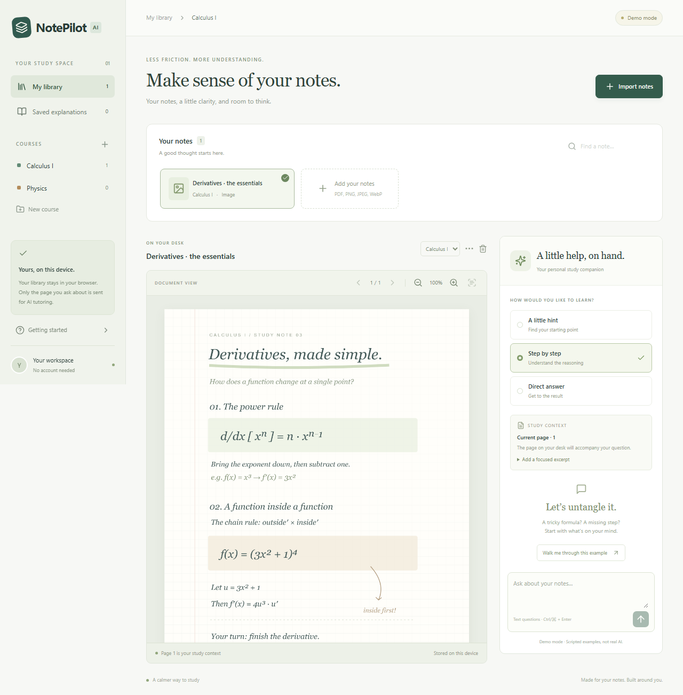

# NotePilot AI

**Your notes, a little clarity, and room to think.**

NotePilot is a local-first study companion for students who write their notes in Goodnotes, KilNotes, Notability, Apple Notes, or another app. Export a page, bring it into NotePilot, and ask for a hint, a worked explanation, or a direct answer. Keep useful explanations without changing the original note.

Built as an internship portfolio project with a working React client, a small TypeScript API, tested provider boundaries, and explicit handling of missing credentials.

Milestone 2 adds voice questions, optional spoken answers, and contextual explanation refinements while preserving the original import-and-study workflow.

## Demo



The app starts with an original synthetic calculus note. With no API key, every response is marked **DEMO · Scripted example**. The calculus example illustrates the interface; demo mode does **not** read imported documents or answer arbitrary questions. No simulated output is presented as real AI.

Try importing [the two-page sample PDF](public/samples/calculus-practice.pdf) to explore navigation and selectable PDF text. The sample notes and illustrations are original, synthetic examples released under CC0; no student documents are included.

## Implemented in Milestone 1

- Course creation/deletion, course filtering, document search, rename, move, and delete.
- Import PDF, PNG, JPEG, or WebP files (up to 25 MB each); library files and kept explanations persist in IndexedDB.
- PDF.js canvas rendering, multiple pages, zoom, and a selectable extracted-text panel for text PDFs.
- Image rendering, current-page context, and an optional focused excerpt for questions.
- Text questions, hint/step/direct modes, and up to six exchanges per conversation. Changing document/page starts a new conversation.
- OpenAI Responses API adapter with the current page image, PDF text or selected excerpt, and conversation history.
- Movable, collapsible, expandable in-app explanations; dismiss, copy, keep, and saved-answer deletion.
- Clearly labeled demo mode, connection status, loading states, cancellation, and actionable errors.
- Responsive desktop/tablet/phone layouts, a web app manifest, icons, and production service worker for offline app-shell access.
- Request validation, payload limits, same-origin API checks, server timeouts, basic per-IP rate limiting, and CI.

## Implemented in Milestone 2

- **Voice drafts:** tap Speak to start, Stop to finish, or Cancel to discard. Browser dictation uses the available `SpeechRecognition` / `webkitSpeechRecognition` implementation; its speech provider may process audio. It works without a NotePilot API key where the browser provides a working service. Browser availability, network access, and permissions vary.
- **Recorded questions:** when server transcription is configured, use Record + transcribe. The app detects a supported MP4/AAC or WebM/Opus recording format, rather than assuming a browser or codec. Stop releases microphone tracks and exposes a local audio preview. Nothing is uploaded to NotePilot until **Transcribe recording** is tapped.
- **Review before sending:** edit the transcript, select **Use transcript**, then submit the question using the existing Ask button. Transcription never submits a tutoring question automatically. Voice drafts can be used for follow-up questions too.
- **Spoken answers:** Text only is the default. Choose Text + spoken answer to read explanations through the browser speech API, with Play, Pause, Resume, and Stop where available. New explanations try to play when enabled; browsers that require another gesture offer a Play fallback. Starting the microphone, hiding the page, dismissing/collapsing the overlay, or switching back to Text only stops playback. Pause/resume behavior depends on the device speech engine.
- **Contextual tutoring:** Explain further, Explain more simply, and Show another method reuse the current page, selected excerpt, original problem, conversation, and tutoring mode. They preserve unsent question drafts. Demo examples remain explicitly scripted.
- **Touch reading:** larger explanation text, touch targets, scrollable math, pointer capture for dragging, and position resets when expanding or rotating. Keep still saves a separate explanation; imported notes are never modified.

### Voice setup and practical fallbacks

Server recording uses `POST /api/transcribe` and the same server-only OpenAI key as tutoring. In `.env`, set:

```dotenv
OPENAI_API_KEY=your-own-key
OPENAI_TRANSCRIPTION_MODEL=gpt-transcribe
```

The default follows the [official OpenAI file transcription guide](https://developers.openai.com/api/docs/guides/speech-to-text). Change the model only to one supporting the file-transcription endpoint. There is no fake transcription service in demo mode. Without credentials, use browser dictation where it works, your device keyboard's dictation microphone, or typed input.

Microphone recording requires a secure context: **HTTPS or localhost**. An iPad visiting a Windows computer's plain `http://192.168…` development URL cannot use `getUserMedia`. Use a trusted HTTPS origin for on-iPad recording and PWA installation. If a trusted HTTPS proxy on the same Windows machine forwards traffic to NotePilot, set `TRUST_PROXY=loopback` and configure that proxy to preserve Host and sanitize/set `X-Forwarded-Proto` and `X-Forwarded-For`. This lets the backend verify the browser's HTTPS origin; forwarded headers are ignored by default. Keep the API bound to loopback. Dictation language follows the browser's language; keyboard dictation is useful when a different language or an unsupported browser is needed.

Recordings are limited to **60 seconds and 8 MB**, remain in memory only, and are discarded on Cancel, navigation to another study context, or component disposal. Leaving the page stops capture. Canceling a pending permission request also closes any stream granted afterward. Canceled transcription requests are aborted; audio already transmitted cannot be recalled. The server validates MIME type, container header, size, and a shared per-IP request quota before forwarding bounded audio. It does not write or log audio. Browser dictation and speech synthesis use browser/OS services, which may have their own network and privacy behavior.

Speech is a convenience, not a mathematical accessibility engine: common LaTeX is simplified for speech, long answers are chunked, and the on-screen KaTeX equations remain the reference. Physical iPad Safari and live provider-account validation are still required; automated voice tests simulate device events rather than recording a person's microphone.

## Stack

React · TypeScript · Vite · Tailwind CSS 4 · PDF.js · KaTeX · IndexedDB (`idb-keyval`) · Express · Zod · Vitest · Playwright · GitHub Actions.

The backend uses native `fetch`; there is no AI SDK dependency. Icons come from Lucide. `TutorProvider` is the extension point for future Claude and Gemini adapters; those providers are not implemented yet.

## Run locally on Windows

Install **Node.js 24 LTS** (Node 22.13+ is supported) and Git. In PowerShell:

```powershell
npm ci
Copy-Item .env.example .env
npm run dev
```

Open the Vite URL printed in the terminal, normally `http://localhost:5173`. The API runs on `127.0.0.1:3001`; Vite proxies `/api` requests. Both processes stop with Ctrl+C. Dependencies are locked in `package-lock.json`.

### Enable real tutoring

Edit `.env` on the **server**:

```dotenv
OPENAI_API_KEY=your-own-key
OPENAI_MODEL=gpt-4.1-mini
```

Restart the backend after changing environment variables. The model is configurable and must support image input and the Responses API in your account. A configured but invalid key produces an error; it never silently falls back to scripted answers. Leave the key blank to use demo mode.

The adapter follows the [official OpenAI vision input documentation](https://developers.openai.com/api/docs/guides/images-vision). It sends one JPEG page image and the selected text only when a question is submitted, along with that question's previous conversation. `store: false` is set on requests; this does not constitute a promise about all provider retention policies. Review your provider account's data settings before sending private notes.

### Production build

```powershell
npm run build
npm start
```

Open `http://localhost:3001`. Express serves the built client and API from the same origin. API keys are never included in client source or Vite environment variables. `.env` is ignored by Git.

This is a **single-user prototype**, not a public multi-user service. Before exposing a paid AI endpoint publicly, add authentication, per-user quotas, TLS, and deployment-specific proxy/rate-limit configuration. The backend binds to loopback by default; do not expose a keyed endpoint to untrusted users.

## Test on an iPad

1. Connect Windows and iPad to the same trusted Wi-Fi network.
2. Run `npm run dev`; Vite listens on the local network. Visit the Network URL printed by Vite from iPad Safari. Allow Windows Firewall access to the development port only on your private network if prompted. The API remains behind the Vite proxy.
3. For installation and reliable clipboard/browser features, serve the production build through a **trusted HTTPS origin**. Safari on iPad cannot install a service worker from a plain LAN HTTP address. A trusted local HTTPS reverse proxy or HTTPS deployment can provide this; TLS is not bundled.
4. In Safari, use Share → Add to Home Screen. Manifest and service worker are enabled in the production build. After the app and a document type have been opened online, cached assets and the local library remain available offline. AI tutoring always needs a reachable backend.

Tablet and phone layouts are covered in Chromium device emulation. Physical iPad Safari testing is still required; device emulation is not a claim of hardware verification.

## Architecture

```text
React app
  ├─ Library → IndexedDB (courses, document Blobs, kept answers)
  ├─ PDF.js / image canvas → bounded page JPEG + extracted text
  ├─ Question + context + temporary conversation
  └─ POST /api/tutor
       ├─ Same-origin check, body limit, rate limit, Zod validation
       └─ TutorProvider
            ├─ DemoProvider (no key; explicitly scripted)
            └─ OpenAIProvider → Responses API (key stays server-side)
```

- `src/App.tsx`: workspace and conversation state, explicit persistence actions.
- `src/storage.ts`: versioned local library storage and import validation.
- `src/components/DocumentViewer.tsx`: lazy-loaded PDF rendering and page context.
- `scripts/copy-pdf-assets.mjs`: copies PDF.js CMaps, standard fonts, and image decoders locally during install/build, with their bundled licenses.
- `scripts/prepare-offline.mjs`: creates a content-versioned service worker that precaches the built app, PDF worker, and modern math fonts before installation completes.
- `src/components/AnswerOverlay.tsx`: transient answers, pointer dragging, copy controls.
- `src/components/MathText.tsx`: safe text rendering with KaTeX math; no raw model HTML.
- `src/hooks/useVoiceInput.ts`: bounded capture, cancellation, microphone cleanup, local preview, and transcription draft state.
- `src/components/VoiceInput.tsx`: explicit voice actions and editable transcript confirmation.
- `src/components/SpeechControls.tsx`: optional browser speech, playback controls, and interruption handling.
- `src/voice.ts`: format detection, browser compatibility, and spoken-text preparation.
- `shared/tutor.ts`: validated transport contract and provider interface.
- `server/app.ts`: same-origin API, limits, errors, and production static hosting.
- `server/providers.ts`: demo/OpenAI adapters. API calls are stateless on the server.
- `server/transcription.ts`: container checks and multipart OpenAI file transcription without browser credentials or server-side audio storage.

Library writes are saved successfully before UI state is committed; failed saves surface an error. Only kept answers are persisted. Temporary answers and conversation history live in memory. The browser's storage can be evicted or cleared: local persistence is not a backup or cross-device sync. Avoid editing the same library in multiple tabs; multi-tab conflict resolution is not implemented.

## Verification

```powershell
npm run lint
npm run typecheck
npm test
npm run build
npx playwright install chromium
npm run test:e2e
```

Vitest checks validation, blob persistence, provider selection, visual context/history serialization, upstream errors, payload limits, same-origin rejection, and request throttling. Playwright checks real production UI/API demo flow, imports, PDF page rendering, image viewing, local persistence, conversation history, overlay controls, copy/keep, error handling, and responsive navigation. No API key is required for CI. Live OpenAI calls are not exercised by the automated suite; provider HTTP responses are mocked in adapter tests.

Voice coverage includes MP4/WebM format selection, container validation, microphone denial, late permission grants, recording errors, empty/oversized recordings, duration limits, cancellation without uploads, explicit transcription confirmation/retry, transcript editing, retained conversation context, speech playback controls, unsupported-API fallbacks, and native touch pointer events in tablet emulation. Browser tests use fake microphone/speech engines and mocked transcription responses; they never activate the user's physical microphone or speakers.

`API_REQUESTS_PER_MINUTE` defaults to 20 shared tutoring/transcription requests per IP. Playwright starts its isolated demo server with a quota of 200 because all desktop/tablet tests share one IP; API unit tests separately verify the default production limit. The startup configuration accepts integers from 1 to 1000.

GitHub Actions runs lint, tests, type checking/build, and browser tests on pushes and pull requests. Screenshots in `docs/` show the seeded interface and are regenerated by the main browser test.

## Current limits

- Explicit import only. No background access to iPad apps, floating system overlays, or automatic edits to other apps' notes.
- Only OpenAI has a live adapter. Demo output is scripted and does not use the user's question semantically.
- Context is limited to the rendered page (scaled to at most 1600×2200), up to 16,000 text characters, and six conversation exchanges. Very small handwriting may be hard to read.
- No OCR text selection for handwritten images. A focused excerpt may be typed/pasted; rectangular region selection is not implemented.
- Password-protected/corrupt PDFs are rejected with a message. Imported files are locally stored and rendered; do not open untrusted files.
- Copy is supported. PNG/PDF answer export is deferred.
- Browser dictation needs a working browser speech service. Server transcription requires configured credentials. No voice feature is claimed to work offline; playback may depend on downloaded OS voices.
- No cloud sync, accounts, shared library, automatic backup, or external app integration.
- PWA installation needs HTTPS on iPad. Offline PDF support requires the PDF assets to have been loaded online first. AI requests are never cached.

## Roadmap

1. Physical iPad Safari and live transcription-provider validation.
2. Formatted solution export as PNG/PDF and local library backup/restore.
3. Claude/Gemini adapters and cross-provider contract tests.
4. Region context selection, richer PDF selection, and optional authenticated sync.

## License

Code: [MIT](LICENSE). Original files under `public/samples/`: CC0-1.0, dedicated to the public domain. Third-party packages retain their own licenses.
